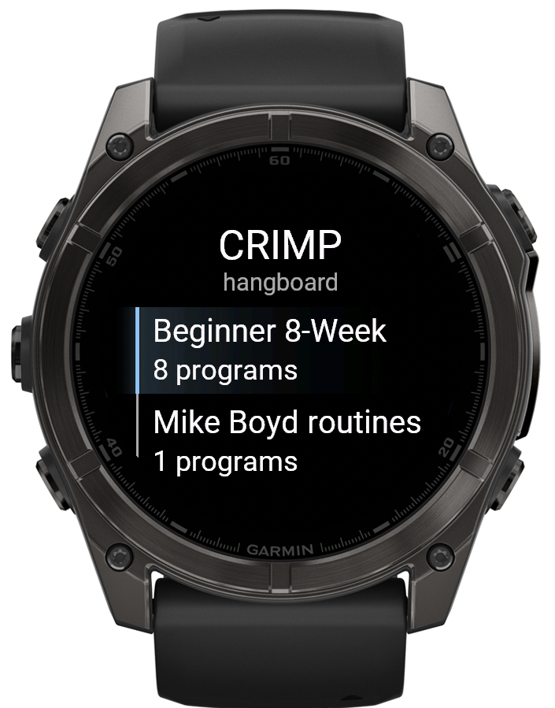

# CRIMP

> **C**RIMP **R**arely **I**njures **M**y **P**ulleys

<p align="center">
  
</p>

A hangboard timer for Garmin watches. Pick a week, hang when it says hang, rest when it says rest,
and let your watch do the counting so you can concentrate on not letting go.

It also records the session as a Garmin activity, so your heart rate and training time end up in Garmin Connect
alongside everything else you do instead of working on your project.

## What it does

- **Countdown timers** for every hang and rest, with a big number you can read from a dead hang.
- **Alerts:** a beep and a buzz on every change, plus a tick for each of the last three seconds. Your eyes
  are busy being on the board.
- **Programs as data.** The 8-week beginner plan is built in, one entry per week, in a folder. Add your own by
  editing a JSON file; no code needed.
- **Pause, skip and quit** from the buttons: START pauses, UP and DOWN skip steps, BACK asks before quitting.
- **Records an activity** (Strength) with a lap for every hang.

## The built-in plan

The "Beginner 8-Week" folder follows the beginner plan from
[99Boulders](https://www.99boulders.com/beginner-hangboard-training). Each week is 10-second hangs, 4 reps
per set, and 2 minutes between sets:

| Week | Sets | Rest between reps |
|------|------|-------------------|
| 1    | 3    | 30 s              |
| 2, 3 | 4    | 30 s              |
| 4    | 5    | 30 s              |
| 5    | 3    | 20 s              |
| 6, 7 | 4    | 20 s              |
| 8    | 5    | 20 s              |

Warm up properly, use good form, and read the safety tips in the original article. A hangboard timer cannot
tell you that your shoulders are up by your ears.

## Supported watches

fēnix 6, 6S, 6 Pro, 6S Pro and 6X Pro; fēnix 7, 7S, 7X, 7 Pro, 7S Pro and 7X Pro; fēnix 8 (43 mm and 47 mm);
and Forerunner 970. The full list is in [`manifest.xml`](manifest.xml).

## Building it

You need the [Connect IQ SDK](https://developer.garmin.com/connect-iq/sdk/), a developer key, and
[`just`](https://github.com/casey/just). On Nix, everything else (Java and Python) comes from `nix-shell`
automatically, so there is nothing more to install.

1. Generate a developer key (see Garmin's docs) and save it as `developer_key` in the project root.
   It is git-ignored. Keep a backup somewhere safe: Garmin ties app updates to it.
2. Build and run:

```sh
just run fenix843mm     # build, start the simulator, run on a Fenix 8 43mm
```

| Recipe                | What it does                                              |
|-----------------------|-----------------------------------------------------------|
| `just`                | List all recipes                                          |
| `just check`          | Validate `resources/programs/programs.json`               |
| `just show "Week 1"`  | Print every step of a program                             |
| `just build [device]` | Build one device (default `fenix7`), output in `bin/`     |
| `just build-all`      | Build every device in the manifest                        |
| `just run [device]`   | Build, start the simulator, and run                       |
| `just export`         | Make `bin/crimp.iq`, the package for Garmin's developer portal |
| `just clean`          | Delete `bin/`                                             |

The `DEVELOPER_KEY` and `DEVICE` environment variables override the defaults.

### Without Nix

Drop `set shell := ...` from the [`justfile`](justfile) and make sure `java` (11 or newer) and `python3`
are on your PATH.

## Getting it onto a watch

**By USB:** build the file for your exact model (`just build fenix7s`), connect the watch, and copy
`bin/<model>.prg` into its `GARMIN/Apps/` folder. A file built for another model will not run.

**Through the Connect IQ Store:** run `just export` and upload `bin/crimp.iq` at
[apps.garmin.com/developer](https://apps.garmin.com/developer). The `.iq` file is not something you can send
to a friend's phone; it is only for the portal.

## Adding your own program

Programs live in [`resources/programs/programs.json`](resources/programs/programs.json), as steps and repeats:

```json
{ "name": "Week 1", "description": "10 s hang, 30 s rest, 4 reps per set, 3 sets.", "steps": [
  { "repeat": 3, "name": "Set",
    "do": [
      { "repeat": 4, "name": "Rep",
        "do":      [ { "type": "hang", "sec": 10 } ],
        "between": [ { "type": "rest", "sec": 30 } ] }
    ],
    "between": [ { "type": "rest", "sec": 120, "label": "SET REST" } ] }
]}
```

`between` runs between repetitions, never after the last one, so you do not wait for a rest nobody needs.
Every program needs a `description`: it is the first screen on the watch, and START begins the workout.
Edit the file, run `just check`, then rebuild. Everything is described in
[`docs/program-format.md`](docs/program-format.md).

### Plan editor (browser)

[`web/editor/`](web/editor/) is a client-side editor for `programs.json`. From the project root:

```sh
python3 -m http.server
# open http://localhost:8000/web/editor/
```

It starts with the plans in `resources/programs/programs.json` (the 8-week beginner plan, and any plan added
there later), lets you edit, add and preview plans, and downloads a new `programs.json`. Save that over
`resources/programs/programs.json`, run `just check` and rebuild. Edits are kept in the browser's local storage;
nothing is uploaded. The editor has its own copy of the validation, mirroring `scripts/check_programs.py`.

### Product page

[`web/`](web/) is the product page (`index.html`) plus the editor, published at https://tanso.net/crimp/.
`just publish` in `web/` checks the plans and rsyncs `web/` and `resources/programs/programs.json` to the server
(`CRIMP_REMOTE` overrides the destination, `just publish-dry` shows what would be uploaded).

## Project layout

```
manifest.xml            app ID, version, devices, permissions
source/                 Monkey C code: menus, timer, workout screen
resources/programs/     the training programs (JSON)
scripts/                program file validator
web/                    product page and, in web/editor/, the browser editor for the programs (static files)
docs/                   the program format
justfile                build, run, export
```

## Status

Early, and mostly tested in the simulator. The beeps, the vibration and the activity recording have not been
checked on a real watch yet. If something misbehaves on yours, that is the first place to look.

## Credits and licence

The training plan comes from the [99Boulders](https://www.99boulders.com/beginner-hangboard-training) article
"Hangboard Training for Beginners: A Simple 8-Week Workout". Only the numbers are used, not the text.

CRIMP is free software, released under the
[GNU General Public License, version 3 or later](https://www.gnu.org/licenses/gpl-3.0.html). See
[`LICENSE`](LICENSE). You may use, study, change and share it, and if you share a modified version, it must
stay under the same terms.

```
CRIMP, a hangboard timer for Garmin watches
Copyright (C) 2026 Jan-Frode Myklebust

This program is free software: you can redistribute it and/or modify it under the terms of the GNU General
Public License as published by the Free Software Foundation, either version 3 of the License, or (at your
option) any later version. It is distributed WITHOUT ANY WARRANTY; without even the implied warranty of
MERCHANTABILITY or FITNESS FOR A PARTICULAR PURPOSE. See the GNU General Public License for details.
```

---

*A hangboard will not make you a better climber if you skip the rest. The "R" in CRIMP is only half a joke.*
